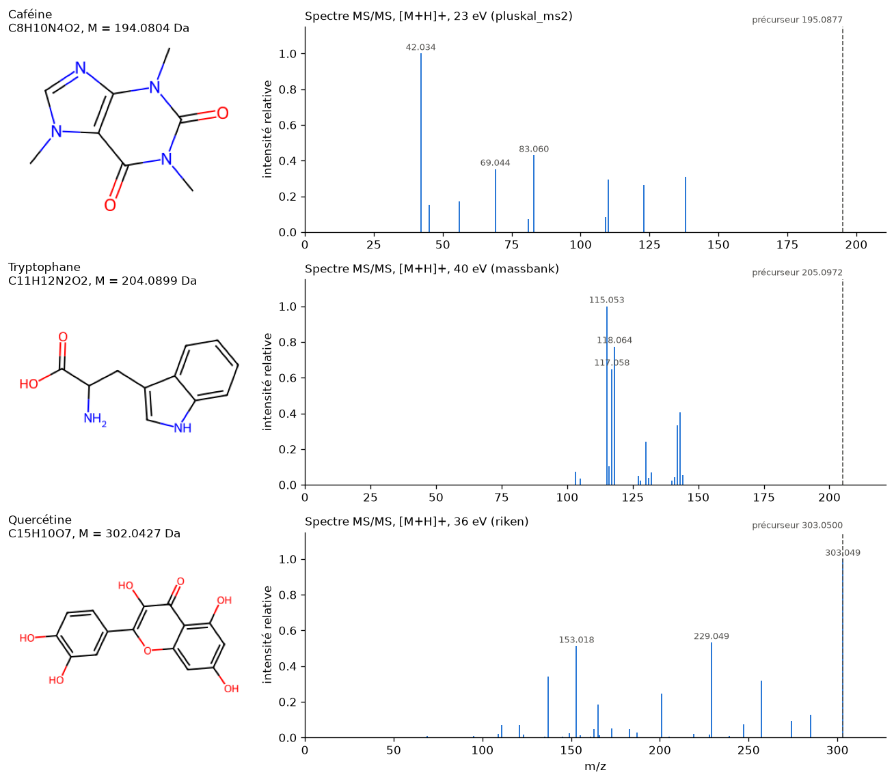

# Fiche chimie : ce qu'il faut savoir pour comprendre les données

Fiche du membre B (tâche B0.1). Chaque chiffre est soit calculé par RDKit (`notebooks/B/00_rdkit.ipynb`), soit mesuré sur nos données (`notebooks/B/01_masse_neutre.ipynb`, `02_filtre_masse.ipynb`), soit tiré d'une source citée en fin de fiche.

## 1. Une expérience de MS/MS, en quatre étapes

1. **Ionisation par électrospray (ESI).** L'échantillon, en solution, est pulvérisé sous haute tension : les molécules passent en phase gazeuse sous forme d'**ions**. C'est une ionisation « douce » : la molécule n'est presque pas cassée [3].
2. **Sélection du précurseur (MS1).** Un premier analyseur ne laisse passer que les ions d'un m/z donné : c'est l'**ion précurseur**, dont le m/z est `precursor_mz` [2].
3. **Fragmentation par collision (CID).** Le précurseur est accéléré contre un gaz neutre, et il se casse en **fragments** [2].
4. **Détection des fragments (MS2).** Un second analyseur mesure le m/z et l'intensité de chaque fragment. Le **spectre MS/MS** est cette liste de pics (`ms2_mzs`, `ms2_normalized_intensities`).

Exemple : la caféine (C₈H₁₀N₄O₂) protonée donne un précurseur à m/z 195,0877. Dans le spectre de la figure (23 eV), ses fragments les plus intenses sont à m/z 42,034, 83,060 et 69,044. Un fragment est toujours **plus léger** que le précurseur : un pic au-dessus du précurseur trahit un spectre bruité.

## 2. Pourquoi `precursor_mz` n'est pas la masse de la molécule : les adducts

L'ESI ne mesure pas la molécule M, mais un **ion** formé à partir d'elle : c'est l'**adduct**. Il s'écrit `[nM ± X]z±` : n molécules, des atomes ajoutés ou perdus, et la charge.

| Adduct | Signification | m/z pour la caféine (M = 194,0804 Da) |
|---|---|---|
| `[M+H]+` | molécule + un proton | M + 1,007276 = **195,0877** |
| `[M-H]-` | molécule − un proton | M − 1,007276 = **193,0731** |
| `[M+Na]+` | molécule + un ion sodium | M + 22,989218 = **217,0696** |
| `[2M+Na]+` | deux molécules + un ion sodium | 2M + 22,989218 = **411,1500** |
| `[M-H2O+H]+` | protonée, puis perte d'une molécule d'eau | M − 18,010565 + 1,007276 = **177,0771** |

Les masses ajoutées sont celles des **ions** : un proton pèse 1,007276 Da, soit un atome d'hydrogène (1,007825 Da) moins un électron (0,000549 Da) [1]. Pour retrouver M, on inverse la formule. C'est ce que fait `compute_neutral_masses` dans `src/casmi/mass.py`.

Dans nos données : 121 adducts différents, dominés par `[M+H]+` (52 %), `[M-H]-` (18 %), `[2M+Na]+` (7 %) et `[M+Na]+` (7 %).

## 3. Mode positif et mode négatif

- En **mode positif**, la molécule gagne une charge positive, en général en captant un proton (`[M+H]+`) ou un cation comme Na⁺ ou K⁺ (`[M+Na]+`, `[M+K]+`) [3].
- En **mode négatif**, elle perd un proton (`[M-H]-`) ou capte un anion comme Cl⁻ ou le formiate (`[M+Cl]-`, `[M+CH2O2-H]-`) [1, 3].

Une molécule ne s'ionise pas aussi bien dans les deux modes : les acides passent mieux en négatif, les bases azotées en positif. Dans nos données : 75 % des spectres en mode positif, 25 % en négatif. Pour 6 087 spectres, la charge de l'adduct contredit le mode : ce sont des étiquettes fausses.

## 4. Masse monoisotopique ou masse moyenne ?

- La **masse moyenne** pondère chaque élément par l'abondance naturelle de ses isotopes (le carbone 13, par exemple). C'est celle de la chimie de paillasse : caféine **194,1940** Da.
- La **masse monoisotopique** utilise l'isotope le plus abondant de chaque élément (¹²C, ¹H, ¹⁴N, ¹⁶O). C'est celle de la caféine sous sa forme la plus fréquente : **194,0804** Da.

Le spectromètre « voit » chaque forme isotopique séparément, et le précurseur sélectionné est en général la forme monoisotopique. On utilise donc la **masse monoisotopique** (`Descriptors.ExactMolWt` dans RDKit). Les deux valeurs diffèrent ici de 0,114 Da, soit **585 ppm** : avec la masse moyenne, la bonne molécule sortirait de n'importe quelle fenêtre de tolérance.

## 5. L'erreur en ppm, et la précision des instruments

Une erreur en **ppm** (partie par million) est une erreur relative : (masse mesurée − masse théorique) / masse théorique × 10⁶. Par exemple, 10 ppm de 300 Da font 0,003 Da, et 5 ppm de la caféine (194 Da) font 0,001 Da.

Un Orbitrap atteint couramment quelques ppm, et moins de 1 ppm en moyenne avec une calibration interne [4]. Dans nos données, les instruments sont surtout des timsTOF (45 % des spectres), des Orbitrap (29 %) et des Q-TOF. **92,5 % des spectres sont à moins de 5 ppm**, 95,1 % à moins de 10 ppm, avec de fortes différences entre bibliothèques : riken n'a que 73,9 % de ses spectres à moins de 10 ppm. C'est ce qui a fait choisir une tolérance de 10 ppm pour le filtre par masse.

## 6. Les isomères : pourquoi la masse ne suffit pas

Des **isomères** ont la même formule brute, donc exactement la même masse, mais des structures différentes. Le glucose et le fructose sont tous deux C₆H₁₂O₆, à 180,063388 Da.

Dans notre catalogue, **90,6 % des molécules partagent leur formule** avec au moins une autre, et une molécule a en médiane 20 isomères exacts. Aucune précision de mesure ne les départagera : seuls les **fragments** du spectre peuvent le faire.

## 7. SMILES, InChIKey et `inchikey14`

- Un **SMILES** écrit une structure en une ligne de texte : `CC(=O)O` est l'acide acétique, `Cn1cnc2c1c(=O)n(C)c(=O)n2C` la caféine. Une même molécule peut s'écrire de plusieurs façons. RDKit en donne une forme **canonique** unique (`Chem.MolToSmiles`).
- L'**InChIKey** est un identifiant de longueur fixe, en trois blocs de 14, 10 et 1 caractères, par exemple `RYYVLZVUVIJVGH-UHFFFAOYSA-N` pour la caféine [5] :
  - les **14 premiers caractères** codent la **connectivité**, c'est-à-dire quel atome est lié à quel autre ;
  - le deuxième bloc code le reste (**stéréochimie**, isotopes…), puis le type de clé (`S` pour standard) et la version (`A`) ;
  - le dernier caractère indique l'état de protonation.
- **Deux stéréoisomères ont donc le même `inchikey14`** : ils ont les mêmes liaisons et ne diffèrent que par leur arrangement dans l'espace. La L-alanine et la D-alanine partagent `QNAYBMKLOCPYGJ`, et seul le deuxième bloc change (`REOHCLBHSA` contre `UWTATZPHSA`).

Dans nos données, aucun SMILES ne contient de stéréochimie : une « molécule » est une **structure 2D**, identifiée par son `inchikey14`. L'`inchikey14` recalculé par RDKit correspond à 100 % à la colonne du jeu.

## 8. Ce qu'apporte l'énergie de collision

Plus l'énergie de collision est élevée, plus la molécule est cassée : le précurseur disparaît et les fragments deviennent plus petits. On le voit sur les spectres `[M+H]+` du tryptophane (précurseur à 205,097) :

| Énergie | Pic le plus intense (médiane) | Interprétation |
|---|---|---|
| ≤ 15 eV | 188,07 | perte de NH₃ seulement, il reste un peu de précurseur |
| 15 à 30 eV | 146,06 | fragmentation plus poussée |
| > 30 eV | 118 (souvent 115 ou 91) | petits fragments du noyau indole |

La tendance n'est vraie qu'en médiane : au-delà de 30 eV, 9 spectres sur 64 ont encore 188,07 comme pic principal. Une énergie « en eV » ne se compare en effet pas parfaitement d'un instrument à l'autre. Un même composé donne donc des spectres différents selon l'énergie et l'instrument. Dans nos données, `collision_energy_ev` est une **liste** : 19,5 % des spectres combinent plusieurs énergies (acquisition « étagée »), et 13 % n'en indiquent aucune.

## Sources

1. Fiehn Lab (UC Davis), *MS Adduct Calculator* : formules des adducts, masse du proton (1,007276) et de l'électron. https://fiehnlab.ucdavis.edu/staff/kind/metabolomics/ms-adduct-calculator
2. Wikipédia (en), *Tandem mass spectrometry* : principe MS1, fragmentation, MS2 ; dissociation induite par collision. https://en.wikipedia.org/wiki/Tandem_mass_spectrometry
3. Wikipédia (en), *Electrospray ionization* : ionisation douce, ions `[M+H]+`, `[M-H]-`, adducts sodium, ions multichargés. https://en.wikipedia.org/wiki/Electrospray_ionization
4. Olsen J. V. *et al.*, « Parts per million mass accuracy on an Orbitrap mass spectrometer via lock mass injection into a C-trap », *Molecular & Cellular Proteomics*, 2005 : écart absolu moyen de 0,48 ppm avec calibration interne. https://www.ppu.mrc.ac.uk/node/8699
5. Wikipédia (en), *International Chemical Identifier* : structure de l'InChIKey (blocs de 14, 10 et 1 caractères, connectivité dans le premier bloc). https://en.wikipedia.org/wiki/International_Chemical_Identifier
